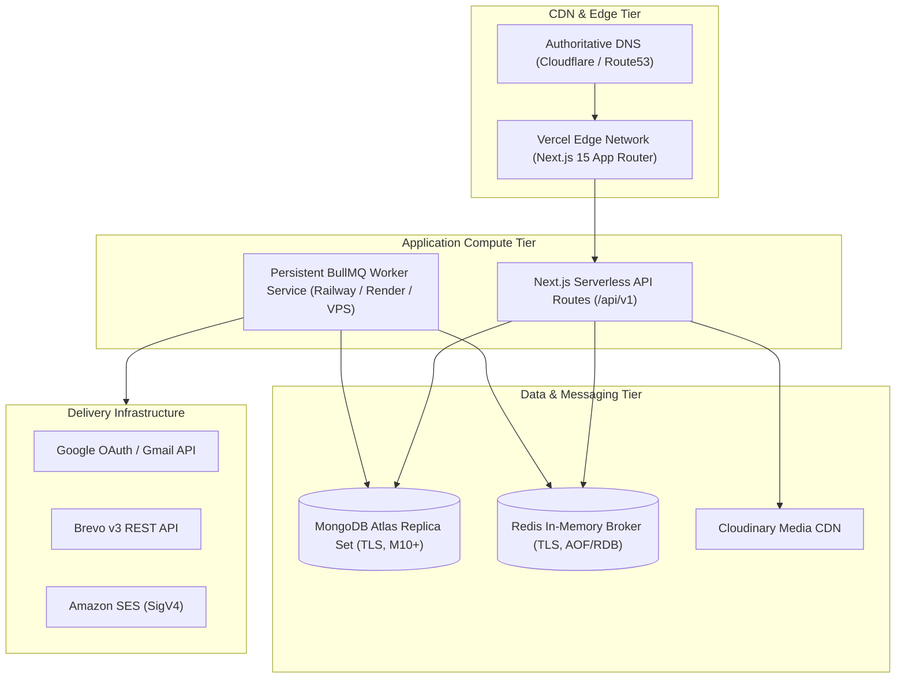

# MailCraft Production Deployment Guide

**Version:** 1.0.0  
**Target Architecture:** Multi-Tier Production Topology (Vercel Frontend/API, Persistent Worker Service, MongoDB Atlas, Redis, Cloudinary)

---

## 1. Production Architecture Overview



---

## 2. Component Deployment Instructions

### Tier 1: Frontend & API (Next.js on Vercel)

1. **Connect Repository**: Import the MailCraft repository into Vercel.
2. **Project Settings**:
   - **Framework Preset**: Next.js
   - **Root Directory**: `apps/web`
   - **Build Command**: `pnpm build`
   - **Install Command**: `pnpm install`
   - **Output Directory**: `.next`
3. **Environment Variables**: Configure all production variables from `.env.production.example`:
   - `NODE_ENV=production`
   - `NEXT_PUBLIC_APP_URL=https://mailcraft.yourdomain.com`
   - `APP_SECRET=<32+ char secret>`
   - `ENCRYPTION_KEY=<64 hex chars>`
   - `MONGODB_URI=<Atlas URI>`
   - `REDIS_URL=<Redis URI with TLS>`
4. **Deploy**: Trigger initial build and assign production domain.

---

### Tier 2: Background Campaign Worker (Persistent Service)

> [!IMPORTANT]
> **Never deploy the BullMQ worker as a serverless function.** Background queue processing, chunk pacing (20ms delay), and long-lived queue listeners require an independent, persistent Node.js process.

1. **Hosting Platform**: Deploy on **Railway**, **Render**, **Fly.io**, or an **Ubuntu VPS**.
2. **Service Configuration**:
   - **Root Directory**: Root of repository or `apps/worker`
   - **Build Command**: `pnpm install && pnpm --filter shared-types build && pnpm --filter database build && pnpm --filter email-renderer build && pnpm --filter email-providers build && pnpm --filter worker build`
   - **Start Command**: `node apps/worker/dist/index.js`
   - **Restart Policy**: `always` or `on-failure` (max retries: 10)
3. **Environment Variables**:
   - `NODE_ENV=production`
   - `NEXT_PUBLIC_APP_URL=https://mailcraft.yourdomain.com`
   - `APP_SECRET=<same as web>`
   - `ENCRYPTION_KEY=<same as web>`
   - `MONGODB_URI=<Atlas URI with TLS>`
   - `REDIS_URL=<Redis URI with TLS>`
4. **Process Health**: Verify the worker outputs:
   ```
   ✓ Worker connected to MongoDB
   ✓ Workers initialized on BullMQ queues: mailcraft-campaigns & mailcraft-test-emails
   ✓ Dead-Letter Queue (DLQ) ready: mailcraft-campaigns-dlq
   ⚡ Worker listening for incoming promotional email broadcasts...
   ```

---

### Tier 3: Database (MongoDB Atlas)

1. **Cluster Specification**: Minimum M10 cluster with automated continuous backups.
2. **Network Access**:
   - Restrict IP access to Vercel production IP ranges and Worker static IP addresses (or AWS VPC peering if hosted on AWS).
3. **Connection Pooling**:
   - Set `MONGODB_MAX_POOL_SIZE=10` on serverless web functions and `MONGODB_MAX_POOL_SIZE=25` on persistent workers.
4. **Verify Indexes**:
   Execute startup index verification to confirm all compound unique indexes (`{ provider: 1, eventId: 1 }`, `{ campaignId: 1, email: 1 }`) and TTL indexes (`guest_sessions`, `tracking_tokens`, `webhook_event_logs`) are active.

---

### Tier 4: Cache & Message Broker (Redis)

1. **Provider**: Upstash Redis, Railway Redis, or AWS ElastiCache.
2. **Configuration**:
   - Enable TLS (`rediss://...`).
   - Eviction policy: `noeviction` (critical for BullMQ message queues so pending jobs are never evicted under memory pressure).
   - Persistence: AOF (Append-Only File) or RDB snapshots enabled.

---

## 3. Post-Deployment Verification & Smoke Test

Execute the following smoke tests against the deployed URL:

1. **Liveness Probe**:
   ```bash
   curl -i https://mailcraft.yourdomain.com/health/live
   # Expect HTTP 200 with uptime and memory metrics
   ```
2. **Readiness Probe**:
   ```bash
   curl -i https://mailcraft.yourdomain.com/health/ready
   # Expect HTTP 200 with mongodb: connected and redis: connected
   ```
3. **Security Headers Verification**:
   ```bash
   curl -I https://mailcraft.yourdomain.com/
   # Confirm Content-Security-Policy, X-Frame-Options, X-Content-Type-Options are present
   ```
4. **Queue Metrics Check**:
   ```bash
   curl -i https://mailcraft.yourdomain.com/api/v1/health/metrics
   # Expect HTTP 200 with queue counts
   ```

